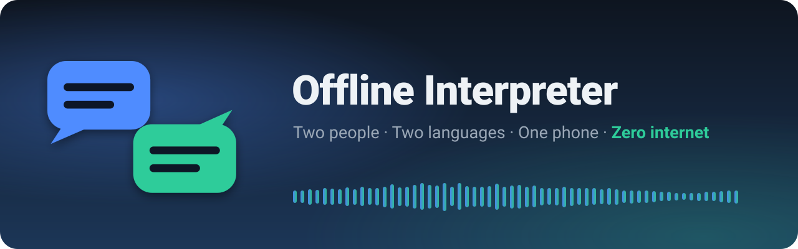
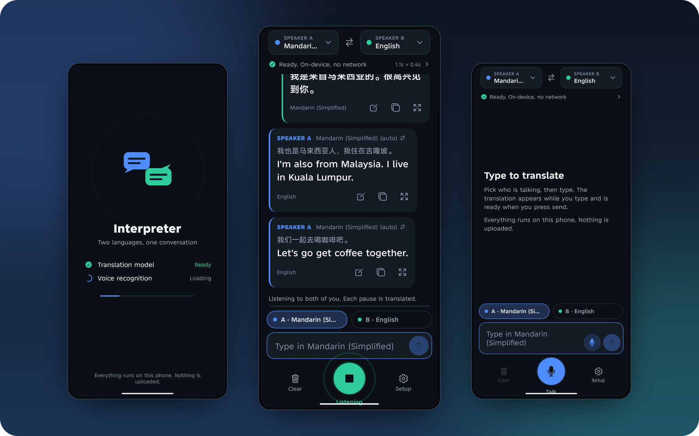
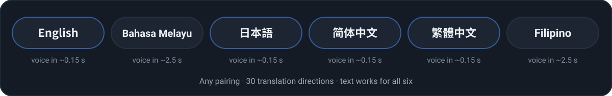
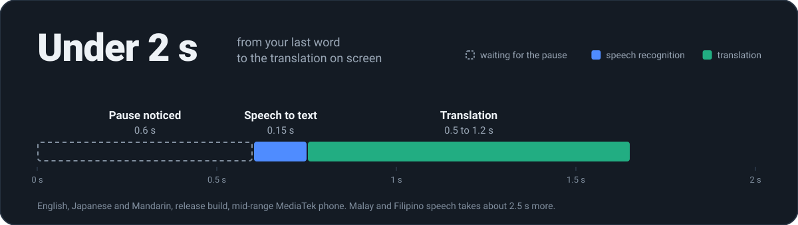
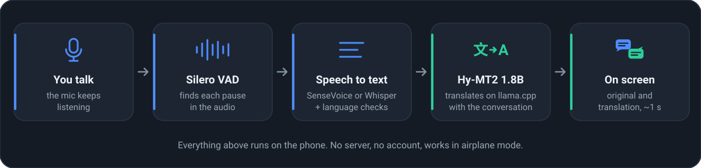

<p align="center">
  
</p>

<p align="center">
  <a href="https://github.com/rexzai1992/offline-interpreter/stargazers"></a>
  
  
  
  
</p>

<p align="center">
  <b>An offline translation app and conversation interpreter for two people and one phone.</b><br />
  Each person talks in their own language. The phone shows what was said and the translation,<br />
  side by side, in about a second. Nothing ever leaves the phone.
</p>

<p align="center">
  <a href="https://github.com/rexzai1992/offline-interpreter/releases/latest/download/offline-interpreter-android-v1.0.0-arm64.apk"></a>
</p>

<p align="center">
  <a href="#quick-start"><b>Quick start</b></a> ·
  <a href="#how-it-works"><b>How it works</b></a> ·
  <a href="#help-wanted"><b>Help wanted</b></a> ·
  <a href="docs/how-it-works.md"><b>Deep dive</b></a>
</p>

<p align="center">
  
</p>

<p align="center"><sub>If this project is useful to you, please <b>star the repository</b>. It helps other people find it.</sub></p>

## Why it's different

<table>
  <tr>
    <td width="33%" valign="top">
      <br />
      <b>Hands-free</b><br />
      Tap once and both people just talk. Every pause is translated while the mic keeps listening.
    </td>
    <td width="33%" valign="top">
      <br />
      <b>Zero internet</b><br />
      Speech recognition and translation run on the phone. Works in airplane mode, underground, abroad.
    </td>
    <td width="33%" valign="top">
      <br />
      <b>About a second</b><br />
      Text in about 0.15 s, translation in 0.5 to 1.2 s on a mid-range phone.
    </td>
  </tr>
  <tr>
    <td valign="top">
      <br />
      <b>Right side, every time</b><br />
      Each message lands on the side of the language actually spoken, accents included.
    </td>
    <td valign="top">
      <br />
      <b>Knows the conversation</b><br />
      The translator sees earlier turns, so names, pronouns and tone stay right.
    </td>
    <td valign="top">
      <br />
      <b>Private by design</b><br />
      No account, no server, no analytics. Nothing is saved unless you ask.
    </td>
  </tr>
</table>

**Also:** translate-while-typing (Send is instant) · a names list so "Takeshi"
stops becoming "Taka she" · full-screen and upside-down view for the person
across the table · warnings when a message is probably wrong.

## Languages

<p align="center">
  
</p>

## Speed

<p align="center">
  
</p>

## How it works

<p align="center">
  
</p>

| Layer | Built with |
|---|---|
| App | React Native · Expo SDK 58 · New Architecture |
| Translation | [Tencent Hy-MT2 1.8B](https://huggingface.co/tencent/Hy-MT2-1.8B-GGUF) on [llama.cpp](https://github.com/ggml-org/llama.cpp) via [llama.rn](https://github.com/mybigday/llama.rn) |
| Speech: English, Japanese, Mandarin | [SenseVoice](https://github.com/FunAudioLLM/SenseVoice) on [sherpa-onnx](https://github.com/k2-fsa/sherpa-onnx), through a small local Expo module |
| Speech: Malay, Filipino | [Whisper](https://github.com/openai/whisper) on [whisper.cpp](https://github.com/ggml-org/whisper.cpp) via [whisper.rn](https://github.com/mybigday/whisper.rn) |
| Pause detection | [Silero VAD](https://github.com/snakers4/silero-vad) |

The engines take turns on the CPU (speech first), the conversation is
pre-loaded into the translator's cache while the next person talks, and every
message is checked for the right language before it is translated. All the
details, measurements and dead ends are in
**[docs/how-it-works.md](docs/how-it-works.md)**.

## Quick start

### Install the APK

**[Download Offline Interpreter v1.0.0](https://github.com/rexzai1992/offline-interpreter/releases/latest/download/offline-interpreter-android-v1.0.0-arm64.apk)**
for arm64 Android phones (Android 8.0+). The app downloads its speech and
translation models during setup (about 1.6 GB, each one asks first and is
checksum-verified); after that, recognition and translation run on-device and
offline. This test build is signed with an Android debug key, so uninstall a
copy signed with a different key before installing it.

### Build from source

```bash
git clone https://github.com/rexzai1992/offline-interpreter.git
cd offline-interpreter
npm install          # also patches whisper.rn and fetches the sherpa-onnx Android library
npx expo prebuild    # generates android/ and ios/ (never edit those by hand)

npx expo run:android # development build on a connected phone

# or a self-contained release APK
cd android && ./gradlew :app:assembleRelease -PreactNativeArchitectures=arm64-v8a
adb install -r app/build/outputs/apk/release/app-release.apk
```

<details>
<summary><b>Requirements and build notes</b></summary>

- Node.js 20+, JDK 17, Android SDK with NDK 27 (Android Studio not required)
- An arm64 Android phone with 4 GB+ RAM (the app refuses below 3 GB) and about
  2 GB of free storage
- Build only `arm64-v8a`: 32-bit phones cannot hold the model, and every extra
  ABI compiles whisper.cpp again. The first build takes several minutes.
- The release APK is signed with the debug key, fine for your own phone. Set up
  your own signing before distributing it.
- iOS needs a Mac with Xcode 16+ and has never been built (help wanted).

</details>

<details>
<summary><b>Models and licenses</b></summary>

Nothing is bundled in the APK; Setup downloads what you choose. Sources and
SHA-256 checksums are in [`src/models/catalog.ts`](src/models/catalog.ts).

| Model | Used for | Size | License |
|---|---|---|---|
| [Hy-MT2-1.8B Q4_K_M](https://huggingface.co/tencent/Hy-MT2-1.8B-GGUF) | Translation, **required** | 1.06 GiB | Apache-2.0 |
| [Silero VAD v6.2](https://huggingface.co/ggml-org/whisper-vad) | Pause detection, **required for voice** | 0.9 MB | MIT |
| [SenseVoice Small int8](https://huggingface.co/csukuangfj/sherpa-onnx-sense-voice-zh-en-ja-ko-yue-2024-07-17) | English, Japanese, Mandarin speech | 239 MB | [FunASR Model License](https://github.com/modelscope/FunASR/blob/main/MODEL_LICENSE) |
| [Whisper small q8_0](https://huggingface.co/ggerganov/whisper.cpp) | Malay and Filipino speech | 252 MB | MIT |
| [Whisper base q8_0](https://huggingface.co/ggerganov/whisper.cpp) | Language checks and fallback | 78 MB | MIT |
| Whisper large-v3-turbo q5_0 | Most accurate, too slow for mid-range phones | 547 MB | MIT |
| Malaysian Whisper small v2 (Mesolitica), converted | Better Malay speech | 252 MB | Not stated by Mesolitica; not hosted yet |

The app's MIT license does not cover the models; each has its own terms.

</details>

## Status

Honest version: it works well on the phone it was built on, and needs more
phones and real-world testing.

| | Area | Notes |
|---|---|---|
|  | Android (arm64) | Infinix X6871, Android 15, MediaTek, 12 GB RAM |
|  | Voice: English, Japanese, Mandarin | Voices played into the mic, accents, two-person dialogues |
|  | Text translation, 30 directions | Desktop with the same model, spot-checked on the phone |
|  | Voice: Malay, Filipino | About 2.5 to 3 s per sentence; Filipino is weak |
|  | Real voices in noisy places | Not tested systematically yet |
|  | iOS | The project generates; never built |
|  | Reading translations aloud, optional Groq cloud mode | Implemented, off by default |

## Known limitations

- **Not simultaneous.** Each piece is translated after a short pause (about 0.6 s, adjustable).
- **Songs and loud music** are often skipped: the speech detector is trained on talking.
- **Garbled audio can give a fluent wrong translation.** The clearest cases are flagged; check the original text above each translation.
- **Numbers, times and names** are the most common mistakes. Tap edit on a message to fix the text; it is translated again.
- **Hokkien and other dialects** are not understood (such messages get a warning).
- **One test phone.** No speed is promised for other devices.

## Help wanted

This is where you come in. Pick one:

| Task | Why it matters |
|---|---|
| **iOS build, and SenseVoice on iOS** | Half the world's phones; the sherpa-onnx module is Android-only today |
| **Test on your phone** | Snapdragon (OpenCL), 4 GB RAM, older devices. Post the timings from the status line |
| **Real voices in real places** | Cafés, streets, people talking over each other |
| **Host the Malay speech model** | Halves Malay word errors; needs a license check ([steps](docs/how-it-works.md#malay-speech-model)) |
| **Better Filipino recognition** | The weakest language today |
| **Noise and music robustness** | Without turning background noise into junk messages |
| **Numbers and times** | The most common translation mistake |
| **More languages** | Where both the translator and a recogniser support them |

## Contributing

Issues and pull requests are welcome.

```bash
npx tsc --noEmit   # typecheck
npx expo lint      # lint
npx jest           # 104 unit tests
```

- **Bug reports:** phone model, Android version, language pair, what was said and what appeared. Logs: `adb logcat -s ReactNativeJS` (development builds log the recognised text; release builds only its length).
- **Performance changes:** say which phone and build type, with before and after numbers.
- **House rules:** never edit `android/` or `ios/` by hand (use `app.json` and config plugins, then `npx expo prebuild`) · add packages with `npx expo install` · keep the app offline by default, and make anything that sends data off the phone opt-in and clearly labelled · text results by default, speech output opt-in. [AGENTS.md](AGENTS.md) has more.

<details>
<summary><b>Project layout</b></summary>

```
App.tsx                         entry: start-up screen, conversation, setup
src/languages.ts                language table: model names, recogniser codes, voices
src/models/                     model catalogue (sizes, SHA-256, licenses) and downloads
src/engine/SpeechRecognizer.ts  microphone, pause detection, recogniser routing, language checks
src/engine/Translator.ts        llama.rn wrapper: prompt, context, cache, sampling
src/engine/cpuTurn.ts           the engines take turns on the CPU
src/engine/textFix.ts           question marks, spacing, times, dialect and echo checks
src/engine/glossary.ts          the names list
src/engine/GroqAsr.ts           optional online recognition
src/engine/Speaker.ts           optional speech output
src/state/useInterpreter.ts     the conversation: turns, previews, voice loops
src/ui/                         screens and components
modules/sensevoice/             local Expo module: SenseVoice via sherpa-onnx (Android)
scripts/fetch-sherpa-onnx.mjs   downloads and verifies the sherpa-onnx library
patches/                        whisper.rn patch (shorter encoder window)
__tests__/                      Jest unit tests
verification/                   desktop and phone measurements, evaluation scripts
docs/                           engineering notes and README graphics
```

</details>

## Privacy

After the models are downloaded the app uses **no network**: no server, no
analytics, no crash reporter. Audio stays in memory and is discarded after
recognition. Conversations are not saved unless you turn on "Save
conversations on this phone". The only exception is the optional Groq cloud
mode, which you must turn on, confirm, and give your own API key.

## Acknowledgements

Standing on the shoulders of
[Tencent Hy-MT2](https://huggingface.co/tencent/Hy-MT2-1.8B-GGUF) ·
[llama.cpp](https://github.com/ggml-org/llama.cpp) ·
[whisper.cpp](https://github.com/ggml-org/whisper.cpp) ·
[OpenAI Whisper](https://github.com/openai/whisper) ·
[SenseVoice](https://github.com/FunAudioLLM/SenseVoice) ·
[sherpa-onnx](https://github.com/k2-fsa/sherpa-onnx) ·
[Silero VAD](https://github.com/snakers4/silero-vad) ·
[llama.rn and whisper.rn](https://github.com/mybigday) ·
[Mesolitica](https://huggingface.co/mesolitica) ·
[Expo](https://expo.dev).

## License

Source code: [MIT](LICENSE). The models the app downloads are not part of this
repository and have their own licenses (see *Models and licenses* above).

<p align="center">
  <br />
  <b>If Offline Interpreter helps you, a star is the best way to say thanks.</b><br />
  <sub>It tells other people the project is worth a look.</sub><br /><br />
  <a href="https://github.com/rexzai1992/offline-interpreter/stargazers"></a>
</p>
