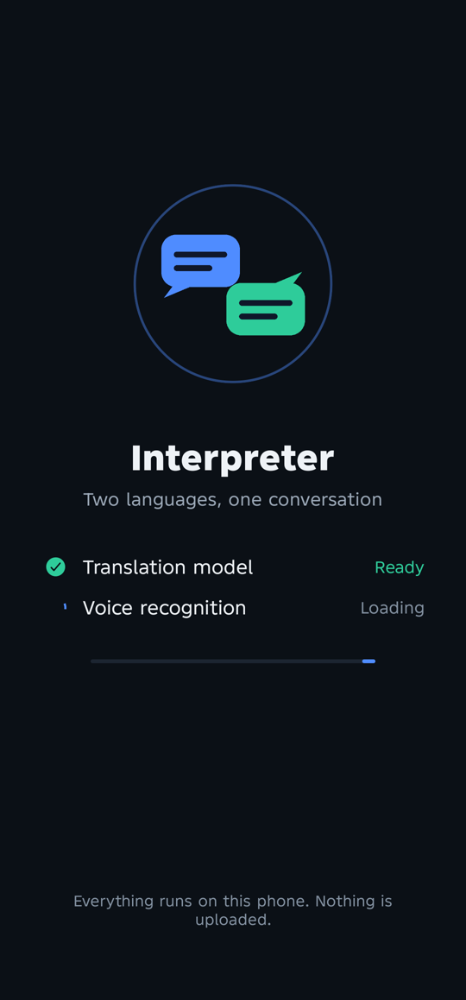
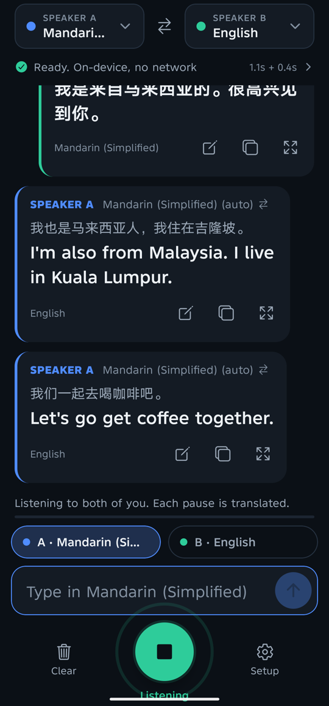
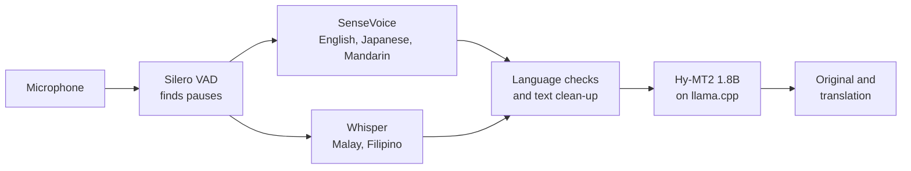

# Offline Interpreter

**An offline translation app and conversation interpreter for two people and
one phone.** Each
person just talks in their own language; the phone shows what was said and the
translation, side by side, in about a second. Speech recognition and
translation run entirely on the phone: no internet, no account, no server.


<p align="center">
  
  &nbsp;&nbsp;
  
</p>

**English · Malay · Japanese · Mandarin (Simplified and Traditional) · Filipino**,
in any pairing.

If this project is useful to you, please **star the repository**. It helps
other people find it.

---

## Contents

- [Features](#features)
- [Status](#status)
- [Get started](#get-started)
- [Models](#models)
- [How it works](#how-it-works)
- [Known limitations](#known-limitations)
- [Help wanted](#help-wanted)
- [Contributing](#contributing)
- [Project layout](#project-layout)
- [Privacy](#privacy)
- [Acknowledgements](#acknowledgements)
- [License](#license)

---

## Features

- **Hands-free conversation.** Tap the big button once and both people just
  talk. Every pause is recognised and translated while the microphone keeps
  listening.
- **The right side every time.** Each message goes on the side of the language
  it was spoken in, whoever tapped what. Accents, Cantonese-sounding Mandarin
  and English written in the wrong script are caught and re-recognised.
- **Fast on a mid-range phone.** English, Japanese and Mandarin speech becomes
  text in about 0.15 s, and the translation follows in 0.5 to 1.2 s.
- **Natural translations with context.** Tencent's Hy-MT2 1.8B translation
  model sees the conversation so far, so pronouns, names and tone stay
  consistent.
- **Type instead of talk.** Typed messages are translated while you type, so
  Send is instant.
- **Names list.** Add names the recognisers have never heard ("Takeshi",
  "Ahmad bin Ismail"); misheard versions are repaired and kept as written in
  the translation.
- **Honest warnings.** Messages that are probably wrong (garbled audio,
  Hokkien, a language outside the pair) say so.
- **Show the other person.** Any translation opens full screen in large text,
  and can be flipped upside down for the person across the table.
- **Private by default.** Nothing is uploaded and nothing is saved unless you
  turn on local history.

---

## Status

This is a working app with honest gaps. It has been built and tested on **one
Android phone**; contributions that test it elsewhere are very welcome.

| Area | Status |
|---|---|
| Android (arm64) | Built and tested on an Infinix X6871 (Android 15, MediaTek, 12 GB RAM) |
| iOS | The project generates but has **never been built** (no Mac with Xcode was available) |
| Text translation, all 30 language directions | Tested on desktop with the same model and runtime; spot-checked on the phone |
| Voice: English, Japanese, Mandarin | Tested with voices played into the phone's microphone, including accents and two-person dialogues |
| Voice: Malay, Filipino | Works, but slower (about 2.5 to 3 s per sentence); Filipino recognition is weak |
| Real voices in noisy places | Not tested systematically yet |
| Reading translations aloud | Implemented, off by default, not verified by ear |
| Optional online recognition (Groq) | Implemented, not tested with a real key |

---

## Get started

There is no published APK yet; build it from source.

**Requirements**

- Node.js 20 or newer
- JDK 17
- Android SDK with NDK 27 (Android Studio is not required)
- An arm64 Android phone with at least 4 GB RAM (the app refuses to load the
  model below 3 GB) and about 2 GB of free storage for models
- For iOS: a Mac with Xcode 16+ and CocoaPods (untested)

**Build and run**

```bash
git clone <this repository>
cd translate-app
npm install          # also patches whisper.rn and fetches the sherpa-onnx Android library
npx expo prebuild    # generates android/ and ios/ (never edit those by hand)

# Development build on a connected phone, with Metro
npx expo run:android

# Or a self-contained release APK
cd android && ./gradlew :app:assembleRelease -PreactNativeArchitectures=arm64-v8a
adb install -r app/build/outputs/apk/release/app-release.apk
```

Build only `arm64-v8a`: 32-bit phones cannot hold the model, and building every
ABI compiles whisper.cpp four times. The first build compiles whisper.cpp from
source and takes several minutes. The release APK is signed with the debug key,
which is fine for your own phone; set up your own signing before distributing
it.

**First launch.** Open **Setup** and download the models. Each download asks
first, shows its size, can be paused and resumed, and is checked against a
SHA-256 before use. After that the app works in airplane mode.

**Checks before a pull request**

```bash
npx tsc --noEmit     # typecheck
npx expo lint        # lint
npx jest             # 104 unit tests
```

---

## Models

Nothing is bundled in the APK; Setup downloads what you choose. Checksums and
sources are in [`src/models/catalog.ts`](src/models/catalog.ts).

| Model | Used for | Size | License |
|---|---|---|---|
| [Hy-MT2-1.8B Q4_K_M](https://huggingface.co/tencent/Hy-MT2-1.8B-GGUF) (Tencent) | Translation, **required** | 1.06 GiB | Apache-2.0 |
| [Silero VAD v6.2](https://huggingface.co/ggml-org/whisper-vad) | Finding speech and pauses, **required for voice** | 0.9 MB | MIT |
| [SenseVoice Small int8](https://huggingface.co/csukuangfj/sherpa-onnx-sense-voice-zh-en-ja-ko-yue-2024-07-17) (FunAudioLLM) | English, Japanese, Mandarin speech, **recommended** | 239 MB | [FunASR Model License](https://github.com/modelscope/FunASR/blob/main/MODEL_LICENSE) |
| [Whisper small q8_0](https://huggingface.co/ggerganov/whisper.cpp) | Malay and Filipino speech | 252 MB | MIT |
| [Whisper base q8_0](https://huggingface.co/ggerganov/whisper.cpp) | Checks and fallback for the others | 78 MB | MIT |
| Whisper large-v3-turbo q5_0 | Most accurate, too slow for mid-range phones | 547 MB | MIT |
| Malaysian Whisper small v2 (Mesolitica), converted | Better Malay speech, when installed | 252 MB | Not stated by Mesolitica; not hosted yet |

The app's own MIT license does not cover these models; each has its own terms.

---

## How it works



- **App:** React Native with Expo SDK 58 (New Architecture, Hermes).
- **Translation:** [llama.rn](https://github.com/mybigday/llama.rn) runs
  llama.cpp with Tencent's Hy-MT2 1.8B, using Tencent's documented prompt
  templates, the conversation as context, and a prompt cache warmed while the
  next person is talking.
- **Speech:** [sherpa-onnx](https://github.com/k2-fsa/sherpa-onnx) runs
  SenseVoice through a small local Expo module (`modules/sensevoice`);
  [whisper.rn](https://github.com/mybigday/whisper.rn) runs whisper.cpp and
  Silero VAD.
- **Scheduling:** the heavy engines take turns on the CPU, speech first, so
  text appears fast and translations catch up in the pauses.

The full engineering notes, with measurements, design decisions and things
that did not work, are in **[docs/how-it-works.md](docs/how-it-works.md)**.

---

## Known limitations

- **Not simultaneous.** Each piece is translated after the speaker pauses
  (about 0.6 s, adjustable).
- **Malay and Filipino voice is slower** (about 2.5 to 3 s per sentence),
  because SenseVoice does not support them and Whisper is used instead.
  Filipino recognition is weak.
- **Songs and loud background music.** The speech detector is trained on
  talking; singing and speech over music are often skipped or misheard.
- **Garbled input can still give a fluent wrong translation.** The clearest
  case is caught and flagged; otherwise check the original text shown above
  each translation.
- **Numbers, times and names** are the most common mistakes. Tap edit on a
  message to correct the text; it is translated again.
- **Very strong accents** can fail. British, Indian, Australian, Irish and
  Malaysian-accented English were recognised correctly in tests.
- **Hokkien and other Chinese dialects are not understood.** Such messages get
  a warning.
- **SenseVoice writes Chinese in Simplified characters**, also for Traditional
  speakers (the translation is unaffected), and it is Android-only for now.
- **Memory:** the translation model needs about 1.4 GB of RAM; Whisper small
  adds about 0.5 GB.
- **One test phone.** No speed is promised for other devices.

---

## Help wanted

Good places to start, roughly in order of impact:

1. **iOS.** Build and test it, and integrate the sherpa-onnx xcframework so
   SenseVoice works on iOS (the module is an Android-only stub today).
2. **Test on more phones**, especially Snapdragon (OpenCL), low-RAM (4 GB) and
   older devices. Post the timings from the status line.
3. **Real voices in real places:** cafés, streets, two people talking over
   each other. Report what breaks, with the language pair.
4. **Malay model hosting.** Confirm the license of Mesolitica's Malaysian
   Whisper and host the converted file so Setup can download it (steps in
   [docs/how-it-works.md](docs/how-it-works.md#malay-speech-model)).
5. **Better Filipino speech recognition.**
6. **Noise and music robustness** without turning background noise into junk
   messages.
7. **Numbers and times** in translation, and more reference translations for
   tricky terms.
8. **More languages**, where both the translator and a recogniser support
   them.

---

## Contributing

Issues and pull requests are welcome.

- **Bug reports:** include the phone model, Android version, the language pair,
  what was said and what appeared. Logs help: `adb logcat -s ReactNativeJS`.
  Release builds log only the length of recognised text; development builds
  log the text itself.
- **Before a pull request:** run the three checks under
  [Get started](#get-started) and add unit tests for logic you change (text
  fixes, routing and scheduling are all unit-tested).
- **Performance changes:** say which phone and build type you measured on,
  with before and after numbers.
- **Project rules:**
  - Never edit `android/` or `ios/` by hand; they are generated. Configure
    native behaviour in `app.json` and config plugins, then
    `npx expo prebuild`.
  - Add packages with `npx expo install <package>` so versions match the Expo
    SDK.
  - Keep the app offline by default. Anything that sends data off the phone
    must be opt-in and clearly labelled.
  - Results are text by default; speech output stays opt-in.
  - Expo changes quickly; check the docs for SDK 58 rather than memory
    ([AGENTS.md](AGENTS.md) has the details).

---

## Project layout

```
App.tsx                         entry: start-up screen, conversation, setup
src/languages.ts                language table: model names, recogniser codes, voices
src/models/                     model catalogue (sizes, SHA-256, licenses) and downloads
src/engine/SpeechRecognizer.ts  microphone, pause detection, recogniser routing, language checks
src/engine/Translator.ts        llama.rn wrapper: prompt, context, cache, sampling
src/engine/cpuTurn.ts           the engines take turns on the CPU
src/engine/textFix.ts           question marks, spacing, times, dialect and echo checks
src/engine/glossary.ts          the names list
src/engine/GroqAsr.ts           optional online recognition
src/engine/Speaker.ts           optional speech output
src/state/useInterpreter.ts     the conversation: turns, previews, voice loops
src/ui/                         screens and components
modules/sensevoice/             local Expo module: SenseVoice via sherpa-onnx (Android)
scripts/fetch-sherpa-onnx.mjs   downloads and verifies the sherpa-onnx library
patches/                        whisper.rn patch (shorter encoder window)
__tests__/                      Jest unit tests
verification/                   desktop and phone measurements, evaluation scripts
docs/how-it-works.md            engineering notes
```

---

## Privacy

After the models are downloaded, the app uses no network. There is no server,
analytics or crash reporter. Microphone audio is held in memory and discarded
after recognition; the conversation lives in memory and is gone when you clear
it or close the app. "Save conversations on this phone" (off by default) keeps
history in the app's private storage, and "Delete history" removes it. The one
exception is the optional Groq recognition mode, which uploads voice only after
you turn it on, confirm, and enter your own API key.

---

## Acknowledgements

Built on the work of:
[Tencent Hy-MT2](https://huggingface.co/tencent/Hy-MT2-1.8B-GGUF),
[llama.cpp](https://github.com/ggml-org/llama.cpp),
[whisper.cpp](https://github.com/ggml-org/whisper.cpp),
[OpenAI Whisper](https://github.com/openai/whisper),
[SenseVoice](https://github.com/FunAudioLLM/SenseVoice),
[sherpa-onnx](https://github.com/k2-fsa/sherpa-onnx),
[Silero VAD](https://github.com/snakers4/silero-vad),
[llama.rn and whisper.rn](https://github.com/mybigday),
[Mesolitica](https://huggingface.co/mesolitica) and
[Expo](https://expo.dev).

---

## License

The app's source code is released under the [MIT License](LICENSE). The models
it downloads are not part of this repository and have their own licenses (see
[Models](#models)).

If Interpreter helps you, **a star on GitHub** is the best way to say thanks.
