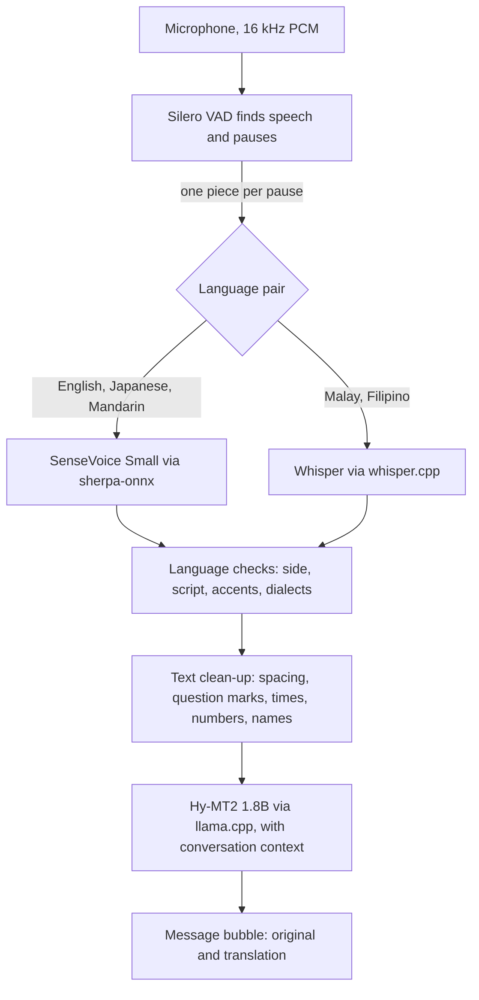

# How it works

The engineering notes behind the app: how speech is cut into pieces, which
recogniser handles which language, how the translation model is prompted, how
the engines share the CPU, and what was measured. Start with the
[README](../README.md) if you have not built the app yet.

## Contents

1. [The pipeline](#the-pipeline)
2. [Listening: cutting speech into pieces](#listening-cutting-speech-into-pieces)
3. [Speech recognition engines](#speech-recognition-engines)
4. [Who said it: language checks](#who-said-it-language-checks)
5. [Text clean-up](#text-clean-up)
6. [Translation](#translation)
7. [Sharing the CPU](#sharing-the-cpu)
8. [Measurements](#measurements)
9. [Malay speech model](#malay-speech-model)
10. [Translation quality notes](#translation-quality-notes)
11. [Speech output](#speech-output)
12. [Optional online recognition (Groq)](#optional-online-recognition-groq)
13. [Release builds](#release-builds)
14. [Verification files](#verification-files)

---

## The pipeline



Typed messages skip the first five steps and go straight to the translator.

Main files: `src/engine/SpeechRecognizer.ts` (microphone, VAD, routing,
language checks), `src/engine/Translator.ts` (prompting, context, cache),
`src/state/useInterpreter.ts` (the conversation and the voice loops),
`src/engine/cpuTurn.ts` (CPU scheduling), `src/engine/textFix.ts` and
`src/engine/glossary.ts` (clean-up, names).

---

## Listening: cutting speech into pieces

Voice input does not wait for you to finish. The microphone streams 16 kHz
PCM; Silero VAD v6.2 (run through whisper.rn) marks where speech is. Each
pause of about 0.6 s (adjustable in Setup) closes a piece, which is recognised
and translated while the microphone keeps recording.

* Pauses are measured in audio samples, not wall-clock time, so a busy phone
  cannot cut a word in half. whisper.cpp reports VAD segment times in
  centiseconds; reading them as seconds was an early bug that cut pieces
  mid-word.
* A piece keeps 0.3 s of audio before the first detected speech and up to
  0.25 s after the last, so word edges are not clipped.
* A piece longer than 8 s is split while the person is still talking, at its
  longest pause, or at its quietest moment if there is none.
* A piece with less than 0.2 s of detected speech is dropped as noise
  (clicks, coughs, breathing). Recognisers turn such audio into junk like
  "The.".
* Tap-to-talk ends after about 2.5 s of silence or a tap. Hands-free mode (the
  big button) keeps listening until you stop it.
* The screen stays on while listening. If the app goes to the background, the
  partial recording is discarded.

Silero is trained on speech. Singing and speech over loud music often score
below its threshold, so parts of a song are skipped entirely. This is expected
behaviour, not dropped audio.

---

## Speech recognition engines

| Engine | Used for | Notes |
|---|---|---|
| **SenseVoice Small** int8, 2024-07-17 (sherpa-onnx 2.0.1) | English, Japanese, Mandarin | About 0.1 to 0.25 s per sentence on the test phone, language identification included. Runs through the local Expo module `modules/sensevoice` (Android only for now). |
| **Whisper small** q8_0 (whisper.cpp via whisper.rn) | Malay, Filipino | About 2.4 to 2.9 s per sentence. A small patch passes whisper.cpp's `audio_ctx`, so only the recorded audio is encoded instead of a fixed 30 s window (this alone took 9.4 to 10.7 s down to 2.4 to 2.9 s). |
| **Malaysian Whisper small v2** (Mesolitica) | Malay, when installed | Half the word errors of Whisper small on Malay. See [Malay speech model](#malay-speech-model). |
| **Whisper base** q8_0 | Fallback and checks | English and Mandarin if SenseVoice is missing; re-recognising accented English that SenseVoice wrote in katakana; the second opinion on the language (below). |

Why these choices:

* SenseVoice matched or beat Whisper on every Japanese, English and Mandarin
  test clip and identified the language correctly every time. It does not
  support Malay or Filipino.
* The 2025-09-09 SenseVoice conversion is a Cantonese fine-tune that failed on
  Japanese, so the 2024-07-17 model is used.
* The phone's NPU is not used: the official sherpa-onnx Android build targets
  an old Android API, so its NNAPI path falls back to the CPU (and NNAPI is
  deprecated in Android 15). llama.cpp and whisper.cpp have no working GPU or
  NPU path on MediaTek phones.

`npm install` runs `scripts/fetch-sherpa-onnx.mjs`, which downloads the
official sherpa-onnx 2.0.1 Android library, checks its SHA-256, and extracts
the Kotlin classes and the arm64 native libraries into
`modules/sensevoice/android` (git-ignored). On iOS the module is a stub that
reports itself unavailable, so iOS uses Whisper.

---

## Who said it: language checks

Each message goes on the side of the language it was **spoken** in, whichever
button was tapped. When both languages are English, Japanese or Mandarin,
SenseVoice detects the language of every piece for free. Detection never leaves
the selected pair. On top of that:

* **Script check.** Japanese characters labelled English are moved to
  Japanese, and so on.
* **Accented English in katakana.** Strongly accented English that SenseVoice
  writes as katakana is recognised again with Whisper.
* **Cantonese to Mandarin.** Mandarin that SenseVoice hears as Cantonese
  (common with Malaysian and southern accents, written as Cantonese words like
  "食唔系") is recognised again as Mandarin.
* **Stray CJK in English.** English with a stray Chinese character ("你ha
  islaysia") is recognised again as English, and kept only if the result is
  clean.
* **Out-of-pair detection.** A detection outside the pair triggers a second
  pass in the closer of the two selected languages. In a field test Whisper had
  heard English as Malay and written the sentence in Malay.
* **Second opinion.** For hands-free pieces of 1.5 s or longer, when the CPU
  is free, Whisper base also guesses the language. If it hears a supported
  language outside the pair (for example Malay in a Mandarin and English
  conversation) and its transcript disagrees with SenseVoice's, the app shows
  Whisper's text, translates that, and adds a note suggesting the right
  language. It gives way to new speech and never delays the next piece.
  Checked on desktop; not yet verified on a phone.
* **Dialects.** Hokkien (阮, 毋, 汝 ...) and leftover Cantonese words get a
  warning on the message: the app understands Mandarin, so the translation may
  be wrong.
* **Echo guard.** If a translation copies an earlier message instead of
  translating the new text (the model filling a gap left by garbled
  recognition), it is translated again without context and marked "The
  recognised text may be wrong". Only judged for sentences of four or more
  words, since short phrases are legitimately repeated.

The detected language is shown on each message and can be corrected with one
tap; the piece is then recognised and translated again.

---

## Text clean-up

Recognised text gets a few safe, deterministic fixes (`src/engine/textFix.ts`,
unit tested):

* No stray spaces inside Japanese or Chinese ("駅の 近 くに" becomes "駅の近くに").
* Question marks on clearly worded English and Mandarin questions ("How much
  is this bag." becomes "How much is this bag?"), including after openers
  ("Hello, can you hear me?"). Commands such as "Have a nice day" are left
  alone.
* English clock times: "7,45" and "at930" become "7:45" and "at 9:30", only
  when the words around them mark a time.
* **Japanese numbers.** SenseVoice's number formatting sometimes half-converts
  them ("三00円" for 三千円, "二五0百円" for 二千五百円). Such pieces are decoded
  again with formatting off, which writes them correctly.
* **Names and special words.** Setup has a list for names the recognisers have
  never heard ("Ahmad bin Ismail", "Takeshi = タケシ"). It is given to Whisper
  as a spelling hint, used to repair near-misses ("Taka she" becomes "Takeshi",
  "I had been a smile" becomes "Ahmad bin Ismail"), and passed to the
  translator so names stay as written. Short names only replace ordinary words
  when nearly identical, so "takes" never becomes "Takeshi".

---

## Translation

* **Model:** `Hy-MT2-1.8B-Q4_K_M.gguf` through llama.rn, `n_ctx` 2048,
  memory-mapped and locked, warmed up after load. Metal on iOS; on Android,
  OpenCL (Adreno) when present, otherwise CPU. The GGUF holds only
  `f32`/`q4_K`/`q6_K` tensors (architecture `hunyuan-dense`) and runs on stock
  llama.cpp. The "STQ kernel" note on the model card applies only to the 2-bit
  and 1.25-bit files.
* **No system prompt** (the model card says the model has none). The GGUF's
  own chat template is applied by llama.cpp.
* **Prompt:** Tencent's documented *Style* and *Background Information*
  templates, in this order: the fixed instructions ("natural everyday spoken
  conversation, same tone and politeness as the speaker; only output the
  translated result"), then previous turns labelled by speaker and language,
  then "Please translate the following text into {language}" and the text.
  Target languages use the model card's English names (`Chinese`,
  `Traditional Chinese`, `Filipino`).
* **Prompt order matters on a phone.** Prompt processing runs at roughly 40 to
  60 tokens/s, so re-reading the instructions every turn costs about half a
  second. With the fixed part first, a 48-turn desktop test processed 37% fewer
  uncached prompt tokens with equivalent translations
  (`verification/desktop/prompt-order-results.txt`).
* **Context** is append-only, so llama.cpp's prefix cache can reuse it. Past
  about 1,100 tokens it restarts from the last two turns.
* **Prefill.** When a translation finishes and nothing else is running, the
  conversation so far is read into the cache while the next person is still
  talking, so the next message only processes its own new text. In speaker
  tests this cut prompt processing from about 1.6 s to about 0.9 s per piece.
* **Sampling:** Tencent's recommendation for the 1.8B model: temperature 0.7,
  top-p 0.6, top-k 20, repetition penalty 1.05. Output length is capped from
  the source length; each request has a 20 s timeout. Lower temperatures were
  tried for short phrases and did not change the results.
* **Translate while typing.** About 0.45 s after typing pauses, the draft is
  translated in the background with exactly the prompt the real message would
  use. Send then commits a finished preview instantly (under 0.3 s on the test
  phone).
* **Reference translations.** Known problem terms are passed through Tencent's
  terminology template ("Reference the following translations: X translates to
  Y"). This covers Filipino clock times (*alas diyes* = 10:00), which the model
  got wrong in most samples (20 of 20 fixed on desktop,
  `verification/desktop/glossary-results.txt`), and the user's names list.
* **Output** is trimmed of wrapping quotes, echoed labels and template tokens,
  and otherwise shown verbatim. Any translation can be opened full screen in
  large text, and turned upside down for the person across the table.

---

## Sharing the CPU

Whisper and the translation model each use every big core. Run at the same
time on a phone they thrash: in a speaker test a 3 s Malay piece took 7.7 s to
recognise instead of 2.5 s, and the translation beside it 7.7 s instead of
about 1 s. `src/engine/cpuTurn.ts` makes heavy jobs take turns:

1. **Speech** (Whisper) goes first, so the text of what was said appears as
   soon as possible.
2. **Translation** next, catching up in the pauses.
3. **Idle** work last: the prefill and the language second opinion.

A running job is never interrupted. SenseVoice is light (about 0.15 s), so it
does not wait for a translation, but idle work does not start while it runs:
beside a prefill, SenseVoice took 0.5 to 0.8 s in a phone test. The second
opinion also gives way to new speech: it only starts when nothing is queued
and is aborted when the next piece arrives (it had delayed the next piece by
0.8 s before this rule).

---

## Measurements

One phone: Infinix X6871, Android 15, MediaTek MT6896, 4 big + 4 little cores
(dotprod, no i8mm), 12 GB RAM, CPU inference. No speed is promised for other
devices.

**Release build, per spoken piece (hands-free, speaker playback)**

| Step | Time |
|---|---|
| SenseVoice recognition (English, Japanese, Mandarin) | 0.08 to 0.25 s |
| Translation with conversation context | 0.5 to 1.2 s |
| Whisper small recognition (Malay, Filipino) | 2.4 to 2.9 s |

**Translation model (development build)**

| Measure | Result |
|---|---|
| Generation speed | 16 to 19 tokens/s; 9 to 13 when the phone was hot |
| Single sentence, no context | 1.2 to 2.8 s end to end |
| CPU threads 2 to 6 | No meaningful difference; llama.rn pins its pool to the big cores |
| App memory with translation and Whisper small loaded | About 3.1 GB |

**Whisper on the phone (3 to 5.5 s clips, development build)**

| Setup | Time |
|---|---|
| Whisper small, full 30 s window (before the patch) | 9.4 to 10.7 s |
| Whisper small, shortened window | 2.4 to 2.9 s |
| Whisper small, auto-detect (Malay or Filipino pair) | 4.4 to 4.8 s |
| Whisper base, English or Mandarin | 0.76 to 0.95 s |
| Whisper large-v3-turbo | 21 to 35 s; unsuitable for this phone |

**Continuous listening.** Synthetic voices were played from a laptop speaker
into the phone's microphone: English paragraphs, a 15 s run-on sentence,
Japanese and Mandarin, seven English accents, and two-person English/Japanese
and Mandarin/English dialogues in tap-to-talk and hands-free mode. Every
sentence became its own piece with no words lost at the cuts, and every
message landed on the side of the language actually spoken. Real voices in
noisy places have not been tested systematically.

Raw results are in `verification/device/`.

---

## Malay speech model

Mesolitica's Malaysian Whisper small v2 is Whisper small fine-tuned on
Malaysian speech, including Malaysian English. Word error rates on 150 clips of
the FLEURS Malay test set (real recorded speech), decoded like the app (greedy,
no fallback):

| Model | Word error rate | Character error rate | Size |
|---|---|---|---|
| Whisper small | 21.8% | 6.8% | 252 MB |
| **Malaysian Whisper small v2** | **10.4%** | **3.2%** | 252 MB |
| Malaysian Whisper base | 19.5% | 5.9% | 78 MB |
| Whisper base | 48.7% | 16.0% | 78 MB |

The same test for Filipino: Whisper small 28.5% word errors, the community
fine-tune `sapinsapin/whisper-small-fsc` 33.3%, so Filipino keeps Whisper
small. Mesolitica's v3 does not work in whisper.cpp yet (an extra vocabulary
token shifts the special tokens). Scripts: `verification/asr-eval/`.

**The converted file is not hosted anywhere yet**, so the Setup screen cannot
download it (help wanted, and check Mesolitica's licence first). To build it:

```bash
# The checkpoint is bfloat16; re-save it as float32 first.
python -c "import torch; from transformers import WhisperForConditionalGeneration as W; W.from_pretrained('mesolitica/malaysian-whisper-small-v2', torch_dtype=torch.float32).save_pretrained('mws-fp32')"
# Copy vocab.json, added_tokens.json and the other *.json files from the model repo into mws-fp32/
python whisper.cpp/models/convert-h5-to-ggml.py mws-fp32 openai-whisper out/
whisper.cpp/build/bin/whisper-quantize out/ggml-model.bin ggml-malaysian-whisper-small-v2-q8_0.bin q8_0
```

`openai-whisper` is a checkout of openai/whisper (for `mel_filters.npz`). Check
the result against the size and SHA-256 in `src/models/catalog.ts`, host it,
and put its direct download address in `MALAY_WHISPER_URL`. To try it on a
development phone without hosting:

```bash
adb push ggml-malaysian-whisper-small-v2-q8_0.bin /data/local/tmp/
adb shell chmod 644 /data/local/tmp/ggml-malaysian-whisper-small-v2-q8_0.bin
adb shell run-as com.craveasia.interpreter cp /data/local/tmp/ggml-malaysian-whisper-small-v2-q8_0.bin files/models/
```

The app checks its SHA-256 on the next start and uses it for Malay.

---

## Translation quality notes

All 30 ordered pairs of English, Malay, Japanese, Mandarin (Simplified),
Mandarin (Traditional) and Filipino were exercised with three-turn informal
conversations (`verification/desktop/translation-matrix-results.txt`).

* Informal register, particles and names are generally preserved ("Thanks
  ha!", "Ate Liza", "Kak Wang", 「ヤバい」).
* Context works: pronouns and "the one earlier" references resolve when
  previous turns are supplied.
* Numbers and times are the most common error (one Japanese to Chinese turn
  changed 十時 to 十二点). *Kedai mamak* was garbled in Japanese and
  Traditional Chinese. One English to Traditional Chinese line came out in
  Simplified characters.
* Very short fragments ("ここで君が") have little to go on and are often
  translated loosely.

---

## Speech output

Off by default; results are text. When turned on, translations are read with
the platform voices (`expo-speech`). The test phone lists Google voices for
en-US, ms-MY, ja-JP, zh-CN, zh-TW and fil-PH; a voice is marked "offline" only
when the engine names it as a local voice. iOS has no Filipino voice. Playback
has not been verified by ear. Listening and playback never overlap, so a
spoken translation cannot be captured as the other person's reply.

---

## Optional online recognition (Groq)

In Setup, "Voice recognition engine" can be switched to Groq's hosted Whisper
large-v3-turbo after an explicit confirmation.

* Each recorded piece is uploaded to Groq. Typed text and all translation stay
  on the phone.
* You supply your own Groq API key. It is stored in the app's private storage
  (AsyncStorage, not encrypted). For a distributed app, put the key behind a
  proxy instead.
* If Groq fails or there is no internet, the app falls back to on-device
  recognition.
* The status line, the Setup status card and the Privacy text all say that
  voice goes to Groq.
* Not yet tested with a real key (the endpoint and request format were checked).

---

## Release builds

* Build only `arm64-v8a`; 32-bit ABIs cannot hold the model, and building all
  ABIs compiles whisper.cpp four times.
* R8 strips fields that sherpa-onnx reads through JNI ("Failed to get field ID
  for decodingMethod"). `app.json` adds ProGuard keep rules for
  `com.k2fsa.sherpa.onnx.**` and `expo.modules.sensevoice.**` through
  `expo-build-properties`.
* Release builds log the length of recognised text, never the text itself.
  Development builds log full text and save the last capture
  (`src/engine/captureDebug.ts`).
* `whisper.rn` is imported as `whisper.rn/index` because its package `exports`
  map has no `"."` entry; `tsconfig.json` maps the types.
* `patches/whisper.rn+0.7.4.patch` is reapplied by `npm install`
  (patch-package). On Android whisper.rn compiles whisper.cpp from source, so
  the patch takes effect; on iOS the prebuilt framework ignores it unless built
  from source (`RNWHISPER_BUILD_FROM_SOURCE=1`).

---

## Verification files

| Folder | Contents |
|---|---|
| `verification/desktop/` | Translation matrix, prompt-order, glossary and Whisper checks run on desktop with the same model and runtime |
| `verification/device/` | Measurements from the test phone |
| `verification/asr-eval/` | FLEURS word error rate scripts and results (Malay, Filipino), Japanese number formatting test |
| `verification/speed-research.md` | Latency research notes |
